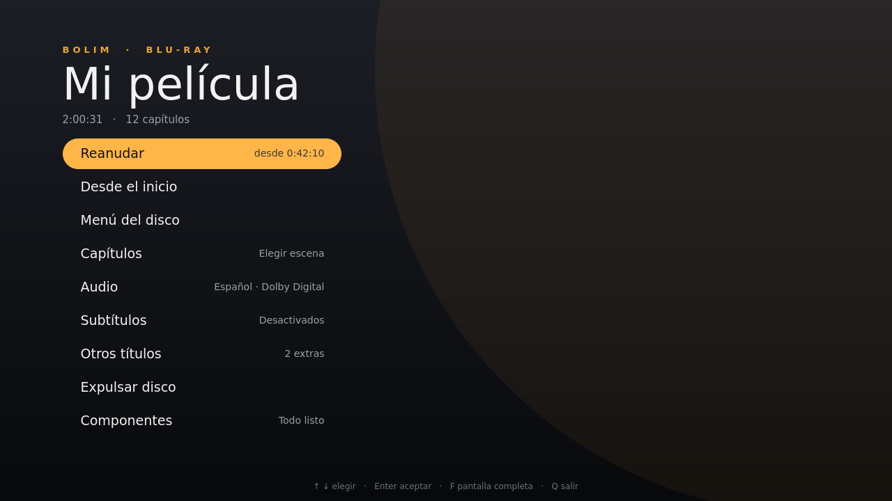

# Bolim Bluray Player

<<<<<<< HEAD
Reproductor de discos Blu-ray con sus menús (HDMV y Java), menú propio de respaldo,
reanudar, otros títulos, nombres de pistas y avisos claros cuando falta algo.

## Abrirlo
Desde el menú de aplicaciones (Multimedia → Bolim Bluray Player) o con `bolim`.
La unidad se detecta sola; para otra: `bolim /dev/sr1` (o una carpeta con BDMV).

## Lo que NO incluye (por razones legales)
- **libaacs**: descifrado de discos comerciales → `sudo apt install libaacs0`
- **libbdplus**: solo para discos con BD+ → `sudo apt install libbdplus0`
- **KEYDB.cfg**: claves de los discos → colócalo en `~/.config/aacs/KEYDB.cfg`

Para menús Java (BD-J): `sudo apt install libbluray-bdj default-jre`.
La opción **Componentes** de la pantalla de inicio muestra qué está instalado y qué falta.

## Teclado
Espacio pausa · ←/→ 5 s · ↑/↓ 1 min · Re Pág/Av Pág capítulos · A/S audio/subtítulos ·
M silencio · [ ] velocidad · Retroceso velocidad 1× · F pantalla completa ·
F2 menú del disco · F3 menú emergente · R reanudar (en el menú del disco) · Q salir

## Archivos
- Registro: `~/.local/state/bolim/bolim.log` (el anterior: `bolim.log.anterior`)
- Posiciones para reanudar: `~/.config/bolim/reanudar.json`
- Mensajes en la terminal en lugar del registro: `bolim --consola`

## Licencias
Incluye PySide6 / Qt 6 (LGPLv3), en `/opt/bolim/lib`.
Usa del sistema: libbluray (LGPL), mpv/libmpv y python-mpv.

## Construir el paquete
`./construir.sh` genera `bolim_<versión>_amd64.deb` (la versión se toma de `bolim/__init__.py`).
Para probar sin instalar: `PYTHONPATH=. python3 -m bolim --consola` (requiere PySide6 disponible).

## AppImage (cualquier distribución, sin instalar)
`./construir-appimage.sh` genera `Bolim_Bluray_Player-<versión>-<arquitectura>.AppImage`.
Funciona en sistemas con glibc igual o más nueva que la del equipo donde se construye
(construida en Ubuntu 24.04: Ubuntu 24.04+, Debian 13/testing y similares).
En una Raspberry Pi (64 bits) se construye en la propia Pi con el mismo script.
Incluye mpv, libbluray y el soporte de menús Java; usa del sistema OpenGL, libaacs,
libbdplus, Java y KEYDB.cfg.
=======
Reproductor de discos Blu-ray para Linux, con menús del disco (HDMV y Java), un menú propio de respaldo, reanudar desde donde te quedaste y una interfaz moderna. Escrito en Python con [libbluray](https://www.videolan.org/developers/libbluray.html), [mpv](https://mpv.io) y Qt Quick.



> **Aviso legal:** Bolim **no incluye** libaacs, libbdplus ni claves de descifrado de discos. Ver [Aviso legal](#aviso-legal).

## Características

- **Menús del disco:** menús HDMV y menús Java (BD-J), con teclado y ratón (el ratón depende de cómo esté hecho cada menú).
- **Menú propio de respaldo:** si el disco no tiene menú o su menú Java no funciona, Bolim muestra el suyo con Reproducir, Capítulos, Audio, Subtítulos y Otros títulos.
- **Reanudar:** recuerda dónde te quedaste en cada disco, con el mismo audio y subtítulos, aunque hayas entrado por el menú del disco.
- **Otros títulos:** acceso a extras como escenas eliminadas o tráileres, cuando el disco los tiene como títulos independientes.
- **Pistas con nombre:** "Español · Dolby Digital · 5.1" en lugar de "Pista 2".
- **Controles cómodos:** clic para saltar 10 segundos y mantener presionado para avanzar a 2×, 4× y 8×; marcas de capítulo en la barra de progreso.
- **Detener y expulsar** desde la interfaz, y cargar otro disco sin cerrar el programa.
- **Avisos claros:** si falta un componente o la clave de un disco, Bolim lo dice en pantalla en lugar de fallar en silencio. La opción **Componentes** muestra qué está instalado y qué falta.

## Instalación

### Paquete .deb (Ubuntu, Xubuntu, Debian)

Descarga `bolim_<versión>_amd64.deb` desde [Releases](../../releases) e instálalo con:

```bash
sudo apt install ./bolim_<versión>_amd64.deb
```

Aparece en **Multimedia → Bolim Bluray Player**. `apt` instala las dependencias necesarias y, como recomendadas, las de los menús Java.

### AppImage (cualquier distribución, sin instalar)

Descarga `Bolim_Bluray_Player-<versión>-x86_64.AppImage` desde [Releases](../../releases):

```bash
chmod +x Bolim_Bluray_Player-*-x86_64.AppImage
./Bolim_Bluray_Player-*-x86_64.AppImage
```

Incluye mpv, libbluray y el soporte de menús Java. Funciona en sistemas con glibc 2.39 o más nueva (Ubuntu 24.04+, Debian 13 y similares). Si no abre, instala `fuse3` o ejecútala con `--appimage-extract-and-run`.

## Requisitos

| Componente | ¿Necesario? | Para qué | Paquete (Debian/Ubuntu) |
|---|---|---|---|
| libbluray | Sí | Leer el disco | `libbluray2` (incluido en la AppImage) |
| mpv | Sí | Reproducir video | `libmpv2`, `python3-mpv` (incluido en la AppImage) |
| numpy | Sí | Dibujar los menús | `python3-numpy` (incluido en la AppImage) |
| libaacs | Para discos comerciales | Descifrado AACS | `libaacs0` — **no incluido** |
| KEYDB.cfg | Para discos comerciales | Claves de los discos | — **no incluido** |
| libbdplus | Solo algunos discos | Protección BD+ | `libbdplus0` — **no incluido** |
| Java + libbluray-bdj | Opcional | Menús Java | `default-jre`, `libbluray-bdj` |
| eject | Opcional | Botón Expulsar | `eject` |

El archivo `KEYDB.cfg` se busca en `~/.config/aacs/KEYDB.cfg`.

## Uso

```bash
bolim                    # detecta la unidad y abre el reproductor
bolim /dev/sr1           # otra unidad, o una carpeta que contenga BDMV
bolim --idioma eng       # idioma preferido para menús, audio y subtítulos (por defecto: spa)
bolim --consola          # mensajes en la terminal en lugar del registro
```

### Teclado

| Tecla | Acción |
|---|---|
| Espacio | Pausa / continuar |
| ← / → | 5 segundos atrás / adelante (en menús: navegar) |
| ↑ / ↓ | 1 minuto adelante / atrás (en menús: navegar) |
| Enter | Aceptar (en menús) |
| Re Pág / Av Pág | Capítulo anterior / siguiente |
| A / S | Cambiar audio / subtítulos |
| M | Silencio |
| [ / ] | Bajar / subir velocidad |
| Retroceso | Velocidad normal (1×) |
| F o F11 | Pantalla completa |
| F2 | Menú del disco |
| F3 | Menú emergente del disco |
| R | Reanudar (dentro del menú del disco) |
| Q | Salir |

## Archivos

| Archivo | Contenido |
|---|---|
| `~/.local/state/bolim/bolim.log` | Registro de la última sesión (la anterior: `bolim.log.anterior`) |
| `~/.config/bolim/reanudar.json` | Posiciones para reanudar cada disco |
| `~/.config/aacs/KEYDB.cfg` | Claves de discos (lo provee el usuario) |

## Solución de problemas

**"Sin clave para este disco".** El disco está cifrado y libaacs no encontró su clave. Revisa que `KEYDB.cfg` la contenga y elige **Volver a intentar**. Si el aviso dice que falta libaacs, instálalo primero.

**El menú del disco no aparece y Bolim regresa a su propio menú.** El menú Java del disco no se pudo ejecutar. Revisa en **Componentes** que Java y libbluray-bdj estén instalados. Algunos discos tienen menús Java que libbluray todavía no soporta por completo; el menú de Bolim permite ver la película igualmente.

**El menú del disco no responde al ratón.** Muchos menús Java están hechos solo para el control remoto. Usa las flechas y Enter.

**Los nombres de idioma de las pistas son incorrectos.** Bolim muestra el idioma que el disco declara para cada pista, y algunos discos vienen mal etiquetados de fábrica.

**Para reportar un error,** adjunta el archivo `~/.local/state/bolim/bolim.log`.

## Compilar desde el código

```bash
git clone https://github.com/rdarkstar/bolim-bluray-player.git
cd bolim-bluray-player

# Ejecutar sin instalar (requiere PySide6 y las dependencias del sistema)
PYTHONPATH=. python3 -m bolim --consola

# Construir el paquete .deb
./construir.sh

# Construir la AppImage (en x86_64 o en una Raspberry Pi de 64 bits)
./construir-appimage.sh
```

`construir-appimage.sh` indica al inicio qué paquetes necesita el sistema. La AppImage funciona en sistemas con una versión de glibc igual o más nueva que la del equipo donde se construye.

### Estructura

```
bolim/
├── __main__.py      # arranque: unidad, registro, revisión de componentes
├── app.py           # controlador de la interfaz y video de mpv dentro de Qt
├── interfaz.qml     # interfaz (Qt Quick)
├── menus.py         # navegación con menús del disco (HDMV y BD-J)
├── disco.py         # acceso al disco con libbluray (ctypes)
└── componentes.py   # detección de componentes externos
empaquetado/         # archivos del .deb y de la AppImage
construir.sh         # genera el .deb
construir-appimage.sh
```

## Aviso legal

Bolim es un reproductor. **No incluye ni distribuye** libaacs, libbdplus, claves de descifrado (`KEYDB.cfg`) ni ningún otro medio para eludir protecciones anticopia, y este repositorio no contiene ni enlaza a esos materiales. Bolim solo detecta si están instalados en el sistema e informa al usuario.

La legalidad de descifrar discos Blu-ray varía según el país. Cada usuario es responsable de cumplir las leyes que le apliquen.

Por favor, **no abras reportes ni envíes cambios que incluyan claves de discos** o enlaces para obtenerlas; serán eliminados.

## Créditos

Bolim se apoya en:

- [libbluray](https://www.videolan.org/developers/libbluray.html) (LGPL-2.1): lectura y navegación de discos Blu-ray
- [mpv](https://mpv.io) / libmpv: reproducción de video
- [python-mpv](https://github.com/jaseg/python-mpv): enlace de Python a libmpv
- [Qt 6](https://www.qt.io) / [PySide6](https://doc.qt.io/qtforpython-6/) (LGPL-3.0): interfaz
- [NumPy](https://numpy.org): composición de los gráficos de menús

## Licencia

Bolim Bluray Player es software libre bajo la [GNU General Public License v3.0](LICENSE).
>>>>>>> 470c2d8d6eb337661f88883041fdbb3d7db3321f
